# DocGitty 🐈 · 稿喵

**给每一个文档一个家，像管理代码那样管理你的文档和项目文件。**

**像Git那样管理你的文档迭代，在反复修改你的论文或者其他内容时，把多版本的文档像代码那样整齐，线性地保存迭代。**

**给agent接入MCP，让ai输出的文档更加规范，保存，浏览更加清晰易懂。**

Windows 本地文档版本与项目资料管理工具。

[下载安装包 · v0.5.7](https://github.com/gezaifeng/DocKitty/releases/download/v0.5.7/DocKitty-Setup-0.5.7-x64.exe) · [最新发布](https://github.com/gezaifeng/DocKitty/releases/latest) · [使用方法](#使用方法) · [完整教程](docs/使用教程.md) · [MCP 接入](docs/MCP接入指南.md) · [反馈问题](https://github.com/gezaifeng/DocKitty/issues)

[更新公告](#更新公告) · [使用方法](#使用方法)

## 更新公告

<!-- 维护约定：新版本公告放在本节最前方，主题与视觉更新优先。公告记录本次变化；下方使用方法只在功能或操作方式发生变化时更新。历史公告保留在 GitHub Releases。 -->

### v0.5.7 · 液态玻璃与项目管理 · 2026-10-14

#### 主题与配色：先挑一个喜欢的工作台

本次新增**浅色 / 深色液态玻璃**与**六组背景配色**，并完善主题选择保存、全局效果开关和关系图缩放时的玻璃渲染。

| 液态玻璃 · 浅色 | 液态玻璃 · 深色 |
| --- | --- |
| 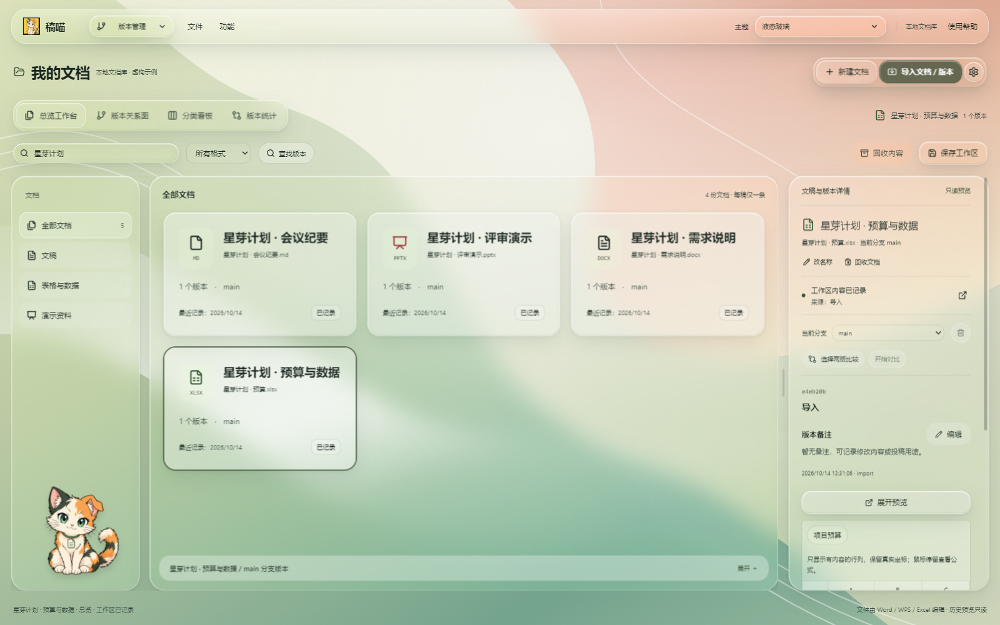 | 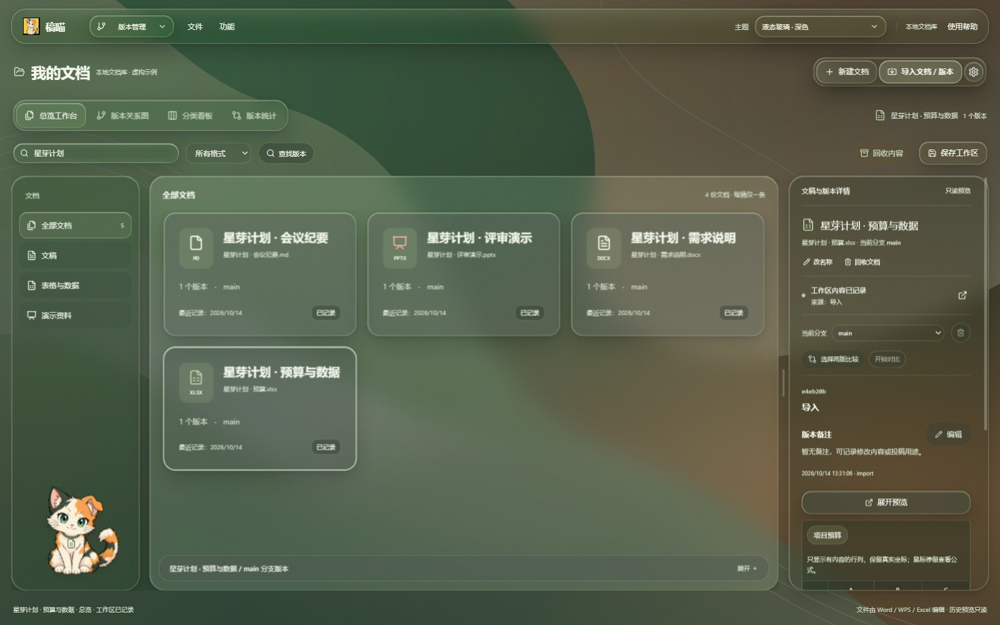 |

流动背景、半透明磨砂、细颗粒和边缘高光共同构成玻璃材质，上层文字保持清晰。指针光效随鼠标同步移动，并在经过的位置留下短暂消退的光迹。为了减少缩放期间的渲染冲突，滚轮缩放时背景短暂停顿，停止约 160ms 后继续流动。

**功能 → 背景配色**切换下面六组颜色，只改变背景颜色，控件和布局保持一致；浅深外观都支持，选择自动保存。

| 玉绿珍珠 | 蓝白 | 粉绿 |
| --- | --- | --- |
| 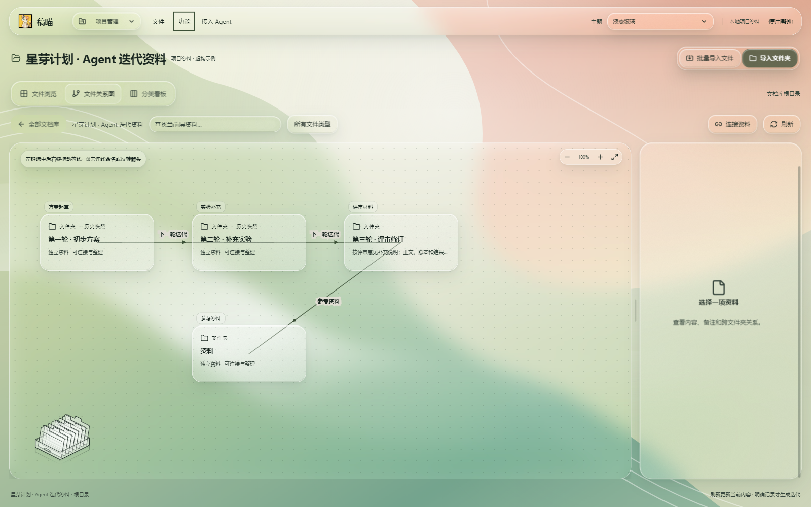 | 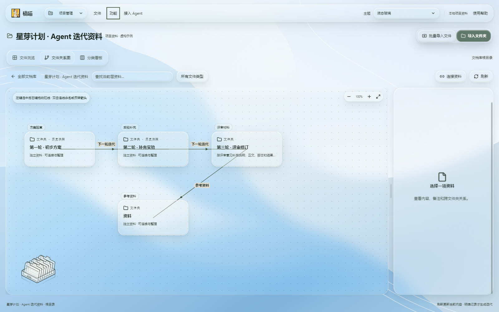 | 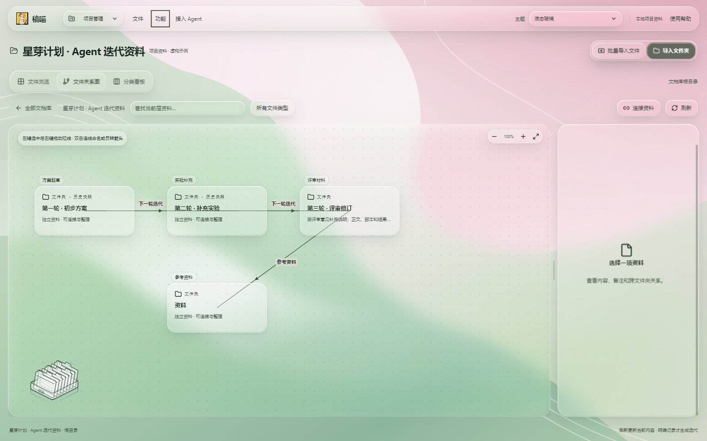 |

| 黄黑 | 紫白 | 橙米 |
| --- | --- | --- |
| 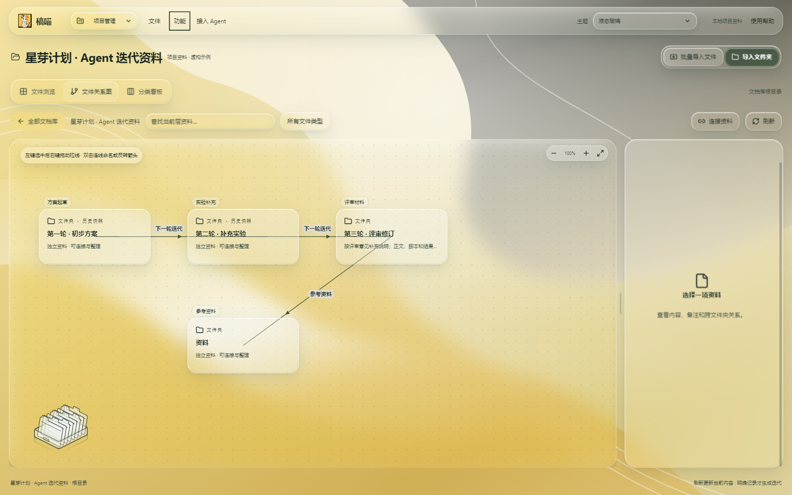 | 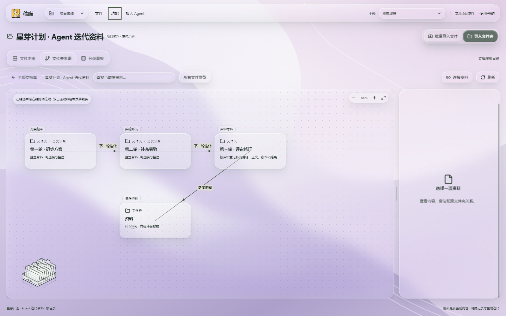 | 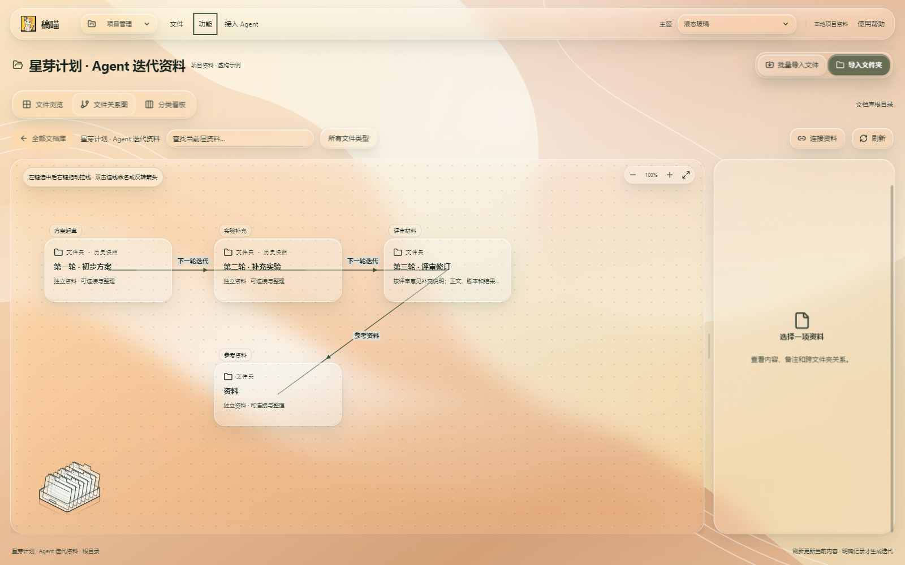 |

<details>
<summary>查看背景配色和全局功能的入口</summary>

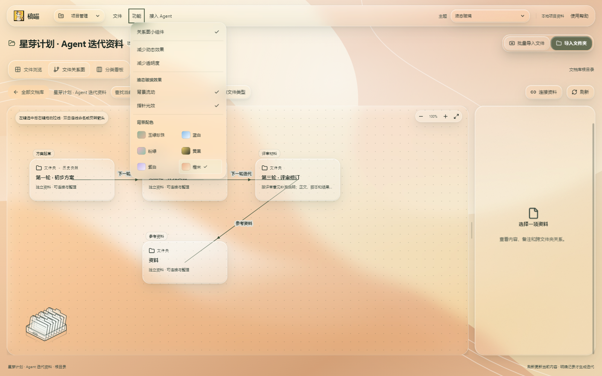

</details>

##### 其他特色主题

九种固定外观包括七种工作台主题，以及液态玻璃的浅色和深色外观，另支持跟随系统。主题会改变边框、投影、控件形状与材质；切换后保留同一份文档、历史和布局，退出重开也保留用户选择。

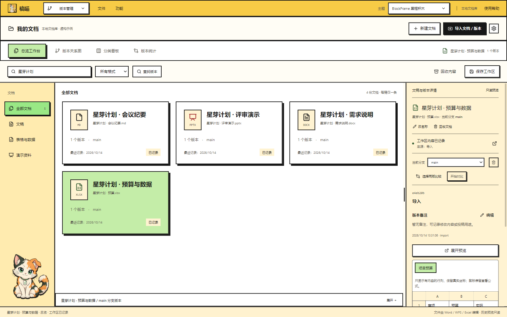

| 粉绿方块 | 经典视窗 | 胶囊文具 |
| --- | --- | --- |
|  |  |  |
| 粉色与浅绿搭配，方块卡片和硬边投影 | 复古窗口、立体控件与桌面软件质感 | 圆润控件、胶囊按钮与文具配色 |

| 浅色办公 | 纸张书房 | 石墨暗色 |
| --- | --- | --- |
| 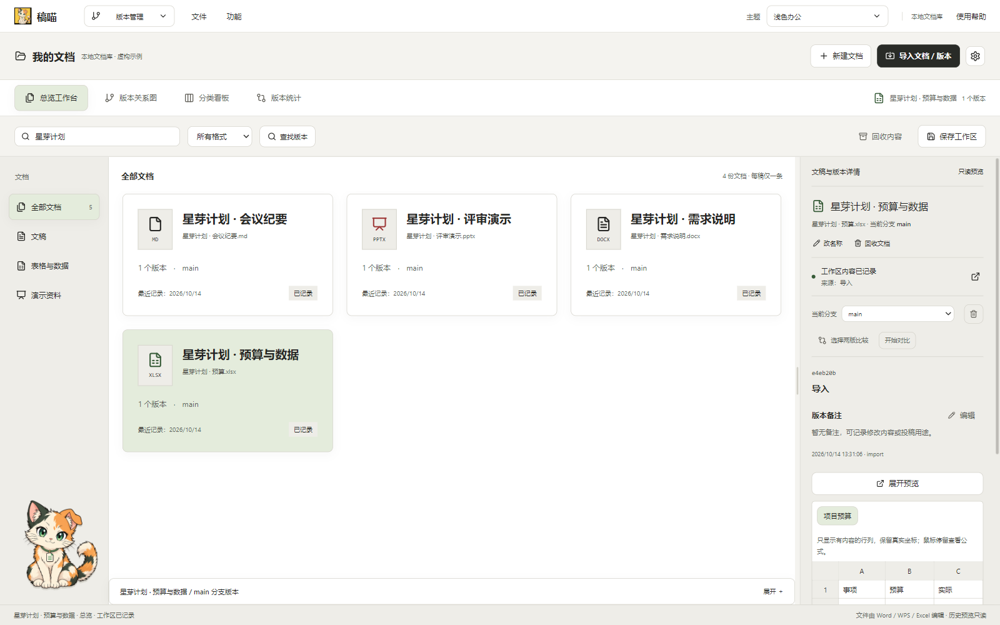 | 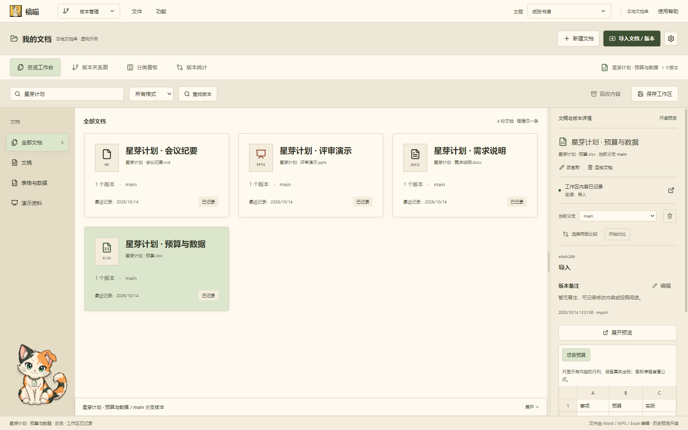 | 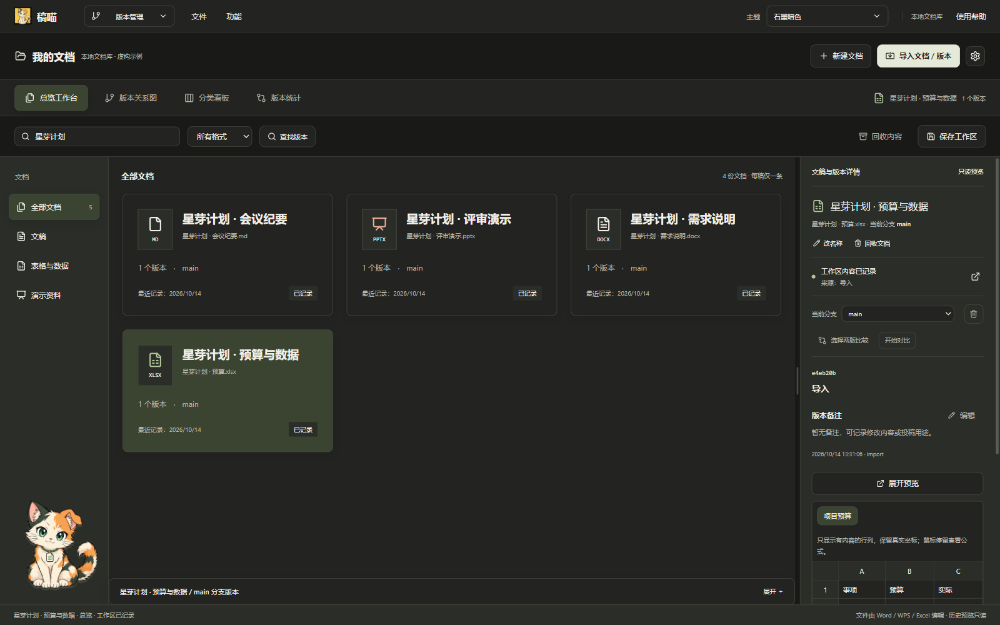 |
| 简洁白色纸面与细边框 | 暖纸底色、墨绿控件和书页气质 | 炭灰背景、柔和亮字和低亮度工作环境 |

> 本页软件截图来自 **v0.5.7** 的实际桌面程序，使用独立示例文档库。研究名称、稿件和项目资料均为虚构数据；本地文档库路径已隐去。截图中的统计数值用于演示功能，不是实际科研结果。

#### 新增项目管理

- 左上角切换“版本管理 / 项目管理”，分别处理单份稿件历史与整组项目资料。
- 批量导入文件或整个文件夹；按当前层浏览，在详情中跳转跨文件夹关系。
- 文件、文件夹均可连接带方向的关系线，并共用项目分类看板。
- 提供展开预览、刷新当前内容、明确记录下一轮，以及 Agent 的 MCP 接入。

[查看项目管理的使用方法](#项目管理整理文件文件夹与迭代)

#### 操作与体验更新

- 双击与右键连线共用一个可拖动编辑面板，关系标签、备注、反转箭头和样式集中编辑。
- 箭头大小、线型与粗细即时预览；版本箭头反转时交换前后关系并阻止循环。
- 文件菜单保留原功能并增加撤回 / 重做；提示约 2.5 秒后消失。
- 关系图小组件可关闭，也可从“功能”菜单重新开启。

[本次完整发布说明](docs/RELEASE-0.5.7.md) · [历史更新公告](https://github.com/gezaifeng/DocKitty/releases)

---

## 使用方法

以下说明按当前版本的功能与操作方式组织。

### 安装与开始使用

**支持 Windows 10 / 11，x64。当前版本：v0.5.7。**

1. 从 [最新发布页](https://github.com/gezaifeng/DocKitty/releases/latest) 下载安装包，也可直接下载 [DocKitty-Setup-0.5.7-x64.exe](https://github.com/gezaifeng/DocKitty/releases/download/v0.5.7/DocKitty-Setup-0.5.7-x64.exe)。
2. 双击安装，从桌面或开始菜单打开“稿喵”，直接进入文档管理界面。
3. 点击“导入文档 / 版本”，导入第一份文档；已有历史稿可继续导入为这份文档的不同版本。
4. 选中文档，切换关系图、分类或统计；右键版本卡片查看可用操作。

安装包已包含运行环境，普通用户**不需要安装 Node.js、pnpm、Python 或 Git**。安装和基本文档管理可离线使用；编辑办公文件仍需已安装的 Word、WPS、Excel 或其他关联程序。安装包目前没有代码签名，Windows 可能显示未知发布者提示。

更详细的操作步骤见 [使用教程](docs/使用教程.md)。

### 选择管理入口

稿喵是一款 Windows 本地文档版本与项目资料管理工具。把一份文档的多次修改收进清晰的历史，也把一个项目的论文、表格、演示和笔记放在同一个文档库里。

你继续用熟悉的 Word、WPS、Excel 编辑，稿喵负责帮你记住：**这一稿从哪里来，改了什么，现在该用哪一稿。**


**同一个软件，两个工作入口。** 左上角切换管理模式：一份稿件的修改历史放在“版本管理”，一组文件和文件夹的整理关系放在“项目管理”。

| 你正在做什么 | 选择哪个入口 | 稿喵怎样帮忙 |
| --- | --- | --- |
| 改论文、准备投稿、回看旧稿 | 版本管理 | 同一文档的版本、分支、分类、对比和量化统计 |
| 整理项目资料、协作交给 Agent、保留整轮文件夹 | 项目管理 | 当前层浏览、文件与文件夹关系、分类看板、刷新和明确记录迭代 |

### 版本管理：保留一份文档的多次修改

写毕业论文、准备投稿、修订方案时，往往会经历这样的过程：

- 初稿已经改了十几轮，仍想找回曾经删掉的一段论证。
- 导师给了一轮意见，需要保留修改前后两份稿件。
- 同一篇论文准备投不同期刊，内容相近，但格式、篇幅和补充材料各有要求。
- 文件夹里堆满“最终版”“最终修改版”“真的最终版”，很难判断它们的关系。

在稿喵里，把这些稿件作为**同一份文档的不同版本**管理。每稿有自己的名称、备注、分支和分类，可以查看、比较或导出旧稿。

#### 用关系图看懂稿件的来龙去脉


箭头表示版本之间的前后关系，从旧稿指向新稿。卡片上方的第一个标签是**分支名称**，第二个是**分类名称**；未分类时不显示第二个标签。

下面是截图中这份示例论文的演进思路：


**版本是一份具体稿件，分支是一组有共同用途的稿件，分类是稿件的整理标签。** 主稿可以一直在 `main` 中迭代；需要同时维护两个投稿方向时，再建 `TIP投稿` 和 `Meas投稿`。普通修改不需要每次新建分支。

关系图支持滚轮缩放、拖动平移和移动卡片。查看某个分支时，只显示归属于它的版本；选择“全部分支的版本”可查看整体关系。你也可以手动连接或断开版本，保留没有连接线的独立稿件，并用“整理布局”恢复默认排布。

左键选中版本后按住右键拖到目标版本即可拉线；双击或右键连线打开同一个可拖动面板，填写关系标签、备注，反转箭头或调整样式。反转实际交换前后关系并阻止循环。文件菜单提供撤回 / 重做，支持 Ctrl+Z、Ctrl+Shift+Z 和 Ctrl+Y；记录仅保留本次启动。永久删除和外部正文修改不会被回退。

#### 在熟悉的编辑器里修改，保留明确的保存规则


这样既能保留修改起点，也不会因为几次小修就生成一串不必要的新版本。需要保留下一阶段时，再发起一次“创建下一稿”。


右键菜单集中提供稿件操作，包括编辑备注、调整分支归属、手动连接版本、导出副本和删除。版本备注会显示在详情里，适合写下“补充方法说明”“按导师意见重写讨论”或“仅调整期刊格式”。

#### 用分类看板整理审阅和投稿状态


分类可以自定义，例如“初稿 / 导师审阅 / 准备投稿 / 已定稿”。拖动稿件卡片可改变分类与显示顺序。**分类用于整理，不改变文件内容，也不等于切换分支。**

#### 看清每一轮修改的量化变化


选择一个统计分支，再从左侧选择指标，就能看到趋势和相对基准的变化。统计分支只改变分析范围，不切换当前编辑分支；可进一步设置基准、版本范围和对照分支。

| 想了解什么 | 可查看的指标与视图 |
| --- | --- |
| 文稿变长还是变短了 | 文本字符数、汉字数、英文词数、中英混合字数与版本趋势 |
| 这一轮动了多少内容 | 新增、删除、净变化、改动强度与内容保留相关指标 |
| 文档结构如何变化 | 适用格式的段落、标题、表格、图片、批注等数量 |
| 表格数据如何变化 | XLSX 工作表、有效单元格、公式及指定数值列统计 |
| 演示材料如何变化 | PPTX 幻灯片及可解析文本等指标 |
| 历史记录与文件体积如何变化 | 文件大小、体积变化、覆盖修订次数、相邻记录间隔 |
| 需要带走分析结果 | 导出统计表 CSV 或趋势图 PNG |

指标随文件格式和可解析内容变化。中英混合字数按汉字与英文词统计，与 Word / WPS 的计数口径可能不同。字数和改动量用于了解修订规模，不能评价文稿质量；记录间隔也不代表实际写作时长。

### 项目管理：整理文件、文件夹与迭代

左上角切换“项目管理”，把一组文件或整个文件夹导入已有文档库，也可新建一个库。论文、说明、HTML 页面、脚本和结果文件可以一起收纳；一个迭代文件夹可以作为一张卡片，保留这一轮的完整内容。

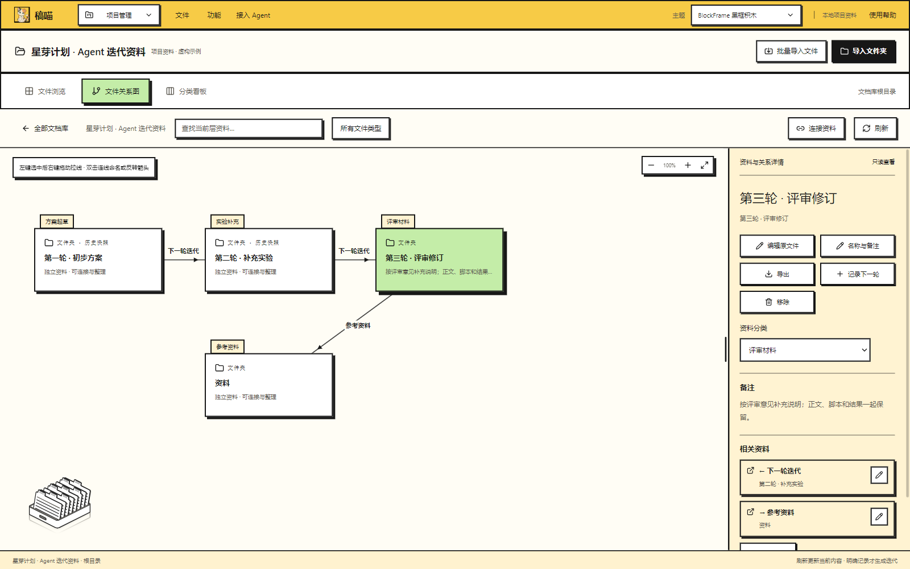

关系可以写成“下一轮迭代”“参考文档”“演示文稿”，直接填写自由文字，无需选择预设类型。两个文件夹也可两两连线，箭头从起点指向目标；左键选中卡片后按住右键拖到目标卡片，松开即可连接，默认不命名。双击或右键连线可修改标签、备注、反转箭头，并实时预览箭头形状、大小、实线 / 虚线 / 双实线与粗细。线条连接卡片中心，位于卡片下层。没有关系的资料可以单纯整理，不强制建立分支。拖动节点整理位置，滚轮缩放和拖动空白移动视图。

#### 一层一层浏览，不把整个项目挤进一张图

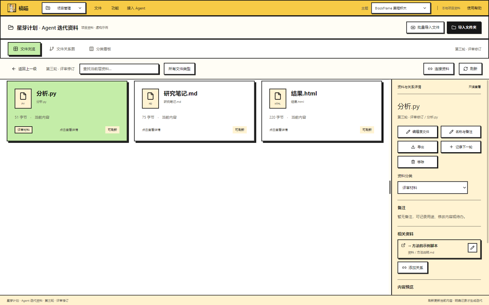

双击文件夹进入下一层。当前图只展示这一层的文件和子文件夹；跨文件夹关系在右侧列出完整路径，点击直接跳到对应资料。文件类型支持多选筛选。侧边栏“展开预览”可在大窗口只读查看当前文件或历史快照，支持文本、Word、Excel及安全HTML页面。

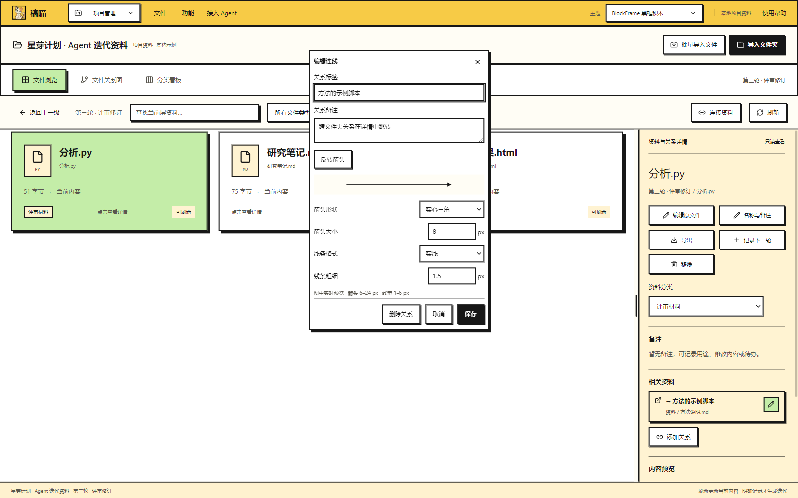

双击与右键均打开“编辑连线”。调整箭头和线型立即在实际关系图上预览，保存后保留，取消恢复原样；所有修改合并为一次可撤回操作。面板可按住标题栏拖动，避免遮挡卡片。文件菜单继续提供导入、保存位置和备份设置，撤回 / 重做提示约 2.5 秒后自动消失。

#### 按用途给当前层资料分类

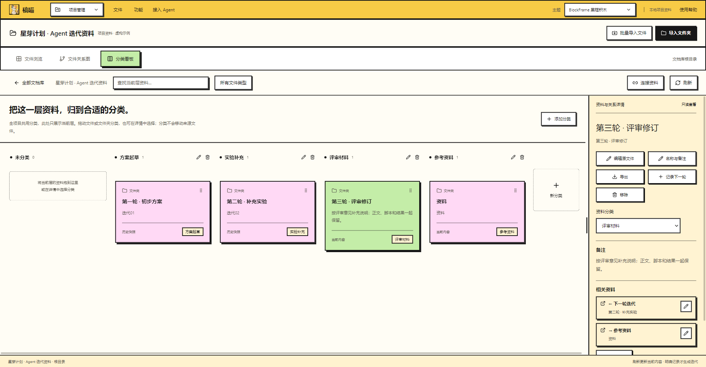

整个项目共用分类名称，看板只展示正在打开的文件夹这一层。文件与子文件夹均可拖到分类列，也可从右侧详情选择；分类同步显示在关系图卡片上方。重命名同步所有层，删除分类只让资料回到“未分类”，保留文件和关系。分类标签不移动来源文件。

#### 需要仔细阅读时，展开预览

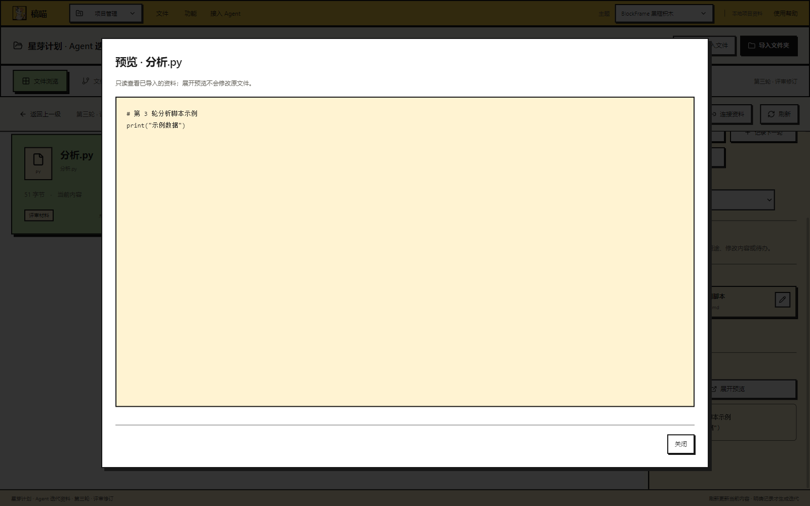

右侧详情提供“展开预览”，把狭窄侧栏中的内容放到大窗口阅读。文本、Word、Excel 和安全 HTML 预览沿用各自的展示方式；预览不修改正文。

#### 同步当前资料，需要历史时再明确记录

项目管理的“编辑原文件”打开导入来源；保存后点击刷新。打开软件、MCP 修改后也会同步。**刷新更新当前卡片，只有“记录下一轮”才新增历史节点。** 需要保留一轮时，应在来源改完、再次刷新之前记录；文件夹可整体记录。

按当前产品规则，来源文件真实删除会同步移除当前和历史卡片及连线，改名按新文件导入；软件内“移除”只移除管理记录。重要内容可事先导出。版本管理入口继续使用独立编辑副本，两种编辑方式在各自页面说明。

#### 让 Agent 把迭代和关系交给稿喵

“接入 Agent”提供 **Codex、Claude Code、Cursor 和 DSH** 的 MCP 配置。Agent 可以导入整轮文件夹、记录新一轮、更新备注、连接参考资料；桌面查看同一份数据。服务使用软件自带运行环境，普通用户不必安装 Node。

[MCP 接入指南](docs/MCP接入指南.md) · [项目管理完整产品规则](docs/项目文档库与Agent迭代管理-产品规格.md)

HTML 只显示安全页面效果，不执行脚本或访问外部网络；MD/PY/CPP 等按文本查看，代码不会运行。软链接只记录目标路径，不展开目标。不支持内嵌预览的格式仍可完整保存和导出。

### 设置主题、配色与全局效果

- **主题**：在右上角的主题菜单中选择外观，退出重开会保留选择。
- **玻璃配色**：选择液态玻璃的浅色或深色外观后，通过“功能 → 背景配色”切换六组颜色；只替换背景颜色，其他布局和控件保持一致。
- **全局效果**：通过“功能”菜单开关关系图小组件、背景流动、指针光效，也可启用减少动态效果或减少透明度。

左下角的小猫支持点击互动和右键抚摸。关系图还提供 Riffle、Drawer、Terminal、Cabinet、Turntable 五种鼠标互动视效，可在视效上右键切换或关闭，也可通过“功能 → 关系图小组件”重新开启。功能菜单同时集中提供减少动态效果、减少透明度、背景流动和指针光效开关。

### 文件与数据：使用前了解这几点

| 项目 | 当前行为 |
| --- | --- |
| 保存位置 | 安装版默认使用当前用户的数据目录；可在设置中自定义位置 |
| 日常编辑 | 版本管理使用独立副本；项目管理的“编辑原文件”直接打开来源 |
| 删除版本 | 可从版本管理中移除；彻底删除来源文件属于单独选项，需要确认具体路径 |
| 备份 | 支持文档库备份与恢复；重要资料建议额外保留独立备份 |
| 卸载 | 不主动删除用户数据目录 |
| 文件格式 | 可保存多种文件的版本；预览、比较和统计的支持范围因格式而异 |

旧式 DOC / XLS 等文件可用于保存版本，但内容解析能力有限。复杂排版、公式计算和最终打印效果请在办公软件中确认。稿喵管理文稿历史，内置预览不替代专业编辑器。

软件当前不提供云同步或团队协作。仓库和安装包均不包含作者论文、个人文档库、测试历史或账户凭据。

## 开发与构建

<details>
<summary>开发者：本地运行、检查与安装包构建</summary>

仅开发或自行构建需要 Node.js 22+、pnpm 9.15.0。

```powershell
pnpm install --frozen-lockfile
pnpm -r run typecheck
pnpm -r run test
pnpm build:desktop
pnpm e2e
pnpm package:installer
```

安装包输出到 `dist/releases`，内部包含 Electron 和打包后的依赖。自动化测试使用隔离文档库；`WORDGIT_ELECTRON` 可指定 Electron 运行环境。与 Word / WPS 的实际编辑配合仍应在目标机器上验证。

本仓库为软件源代码的公开快照；本文截图仅用于功能说明，不构成所有文件格式的兼容性保证。v0.5.7 的版本图 / 项目图缩放、配色切换、完整退出后的选择保存已用打包程序验证；安装包已生成并校验，本轮未重新执行安装向导。

</details>

## 第三方与反馈

Hairline 0.5.0（Lucas Marques，MIT）用于 Riffle、Drawer、Terminal、Cabinet、Turntable。原版许可保留于源码和安装目录，参见 [第三方说明](docs/THIRD-PARTY-NOTICES.md)。其他依赖见各包清单。

遇到问题欢迎提交 [Issue](https://github.com/gezaifeng/DocKitty/issues)，附上软件版本、文件格式、复现步骤及隐去敏感信息的截图。请勿上传未公开论文或私人文档。
