# DocKitty 🐈 · 稿喵

**给每一稿一个家。**

稿喵是一款 Windows 本地文档版本管理工具。把一份文档的多次修改收进清晰的历史，也把一个项目的论文、表格、演示和笔记放在同一个文档库里。

你继续用熟悉的 Word、WPS、Excel 编辑，稿喵负责帮你记住：**这一稿从哪里来，改了什么，现在该用哪一稿。**

[下载安装包](https://github.com/gezaifeng/DocKitty/releases/latest) · [使用教程](docs/使用教程.md) · [反馈问题](https://github.com/gezaifeng/DocKitty/issues)

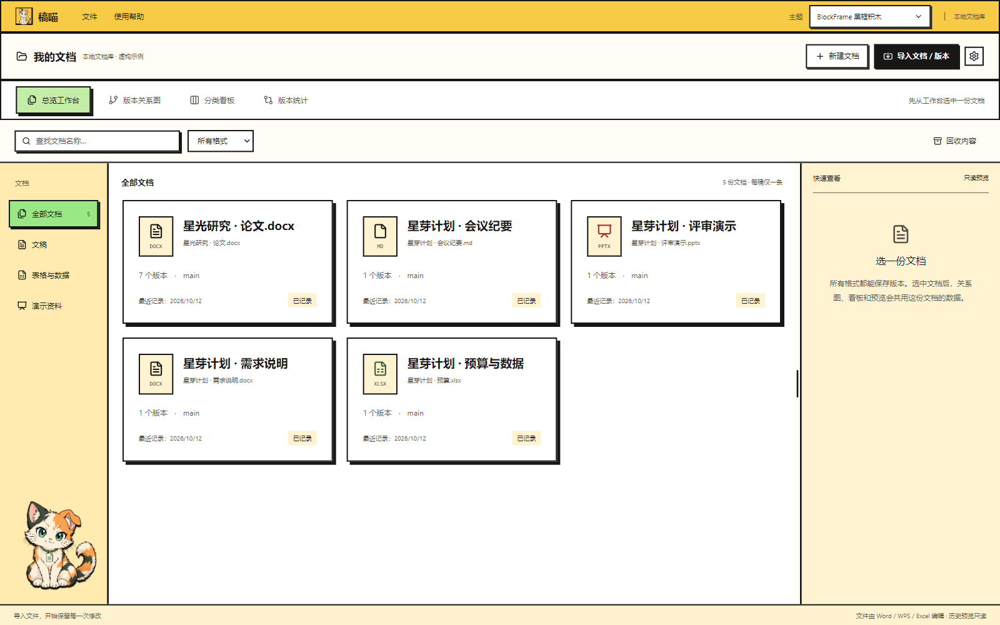

> 本页截图来自 v0.4.0 软件的独立示例文档库。研究名称、稿件和项目资料均为虚构数据；路径显示已隐去。截图中的统计数值用于演示功能，不是实际科研结果。

## 场景一：一份文档，很多次修改

写毕业论文、准备投稿、修订方案时，往往会经历这样的过程：

- 初稿已经改了十几轮，仍想找回曾经删掉的一段论证。
- 导师给了一轮意见，需要保留修改前后两份稿件。
- 同一篇论文准备投不同期刊，内容相近，但格式、篇幅和补充材料各有要求。
- 文件夹里堆满“最终版”“最终修改版”“真的最终版”，很难判断它们的关系。

在稿喵里，把这些稿件作为**同一份文档的不同版本**管理。每稿有自己的名称、备注、分支和分类，可以查看、比较或导出旧稿。

### 用关系图看懂稿件的来龙去脉

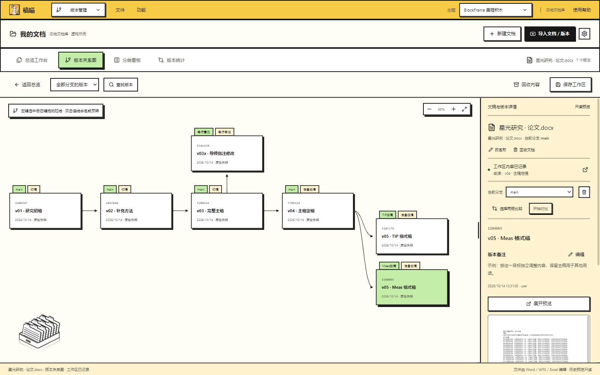

图中的实线表示版本之间的前后关系。卡片上方的第一个标签是**分支名称**，第二个是**分类名称**；未分类时不显示第二个标签。

下面是截图中这份示例论文的演进思路：

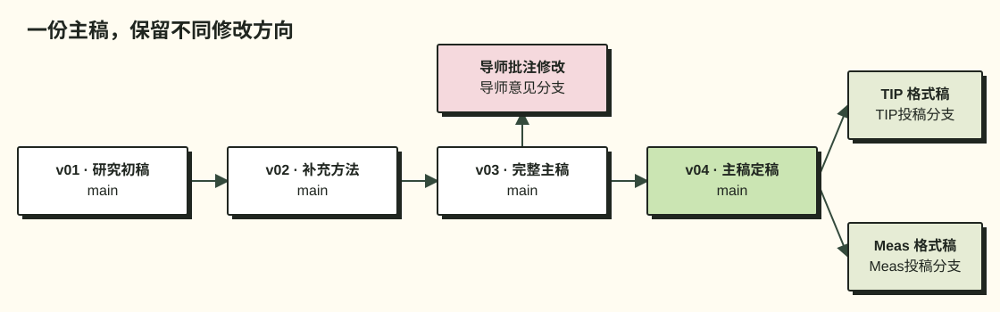

**版本是一份具体稿件，分支是一组有共同用途的稿件，分类是稿件的整理标签。** 主稿可以一直在 `main` 中迭代；需要同时维护两个投稿方向时，再建 `TIP投稿` 和 `Meas投稿`。普通修改不需要每次新建分支。

关系图支持滚轮缩放、拖动平移和移动卡片。查看某个分支时，只显示归属于它的版本；选择“全部分支的版本”可查看整体关系。你也可以手动连接或断开版本，保留没有连接线的独立稿件，并用“整理布局”恢复默认排布。

### 在熟悉的编辑器里修改，保留明确的保存规则

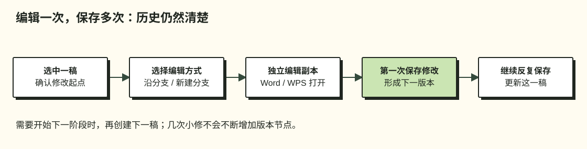

这样既能保留修改起点，也不会因为几次小修就生成一串不必要的新版本。需要保留下一阶段时，再发起一次“创建下一稿”。

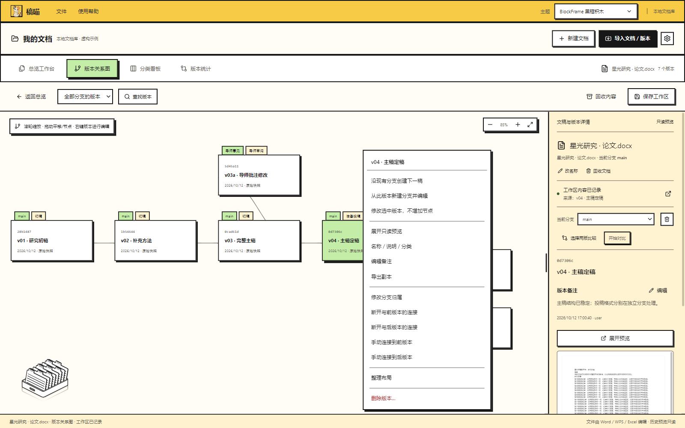

右键菜单集中提供稿件操作，包括编辑备注、调整分支归属、手动连接版本、导出副本和删除。版本备注会显示在详情里，适合写下“补充方法说明”“按导师意见重写讨论”或“仅调整期刊格式”。

### 用分类看板整理审阅和投稿状态

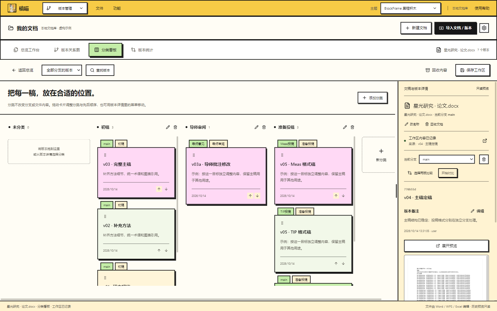

分类可以自定义，例如“初稿 / 导师审阅 / 准备投稿 / 已定稿”。拖动稿件卡片可改变分类与显示顺序。**分类用于整理，不改变文件内容，也不等于切换分支。**

### 看清每一轮修改的量化变化

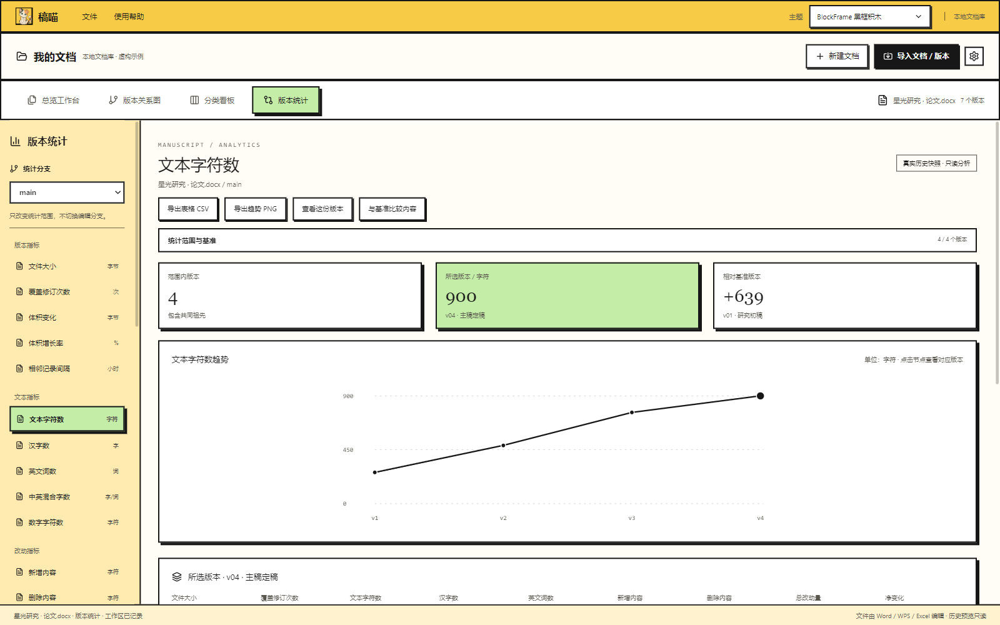

选择一个统计分支，再从左侧选择指标，就能看到趋势和相对基准的变化。统计分支只改变分析范围，不切换当前编辑分支；可进一步设置基准、版本范围和对照分支。

| 想了解什么 | 可查看的指标与视图 |
| --- | --- |
| 文稿变长还是变短了 | 文本字符数、汉字数、英文词数、中英混合字数与版本趋势 |
| 这一轮动了多少内容 | 新增、删除、净变化、改动强度与内容保留相关指标 |
| 文档结构如何变化 | 适用格式的段落、标题、表格、图片、批注等数量 |
| 表格数据如何变化 | XLSX 工作表、有效单元格、公式及指定数值列统计 |
| 演示材料如何变化 | PPTX 幻灯片及可解析文本等指标 |
| 历史记录与文件体积如何变化 | 文件大小、体积变化、覆盖修订次数、相邻记录间隔 |
| 需要带走分析结果 | 导出统计表 CSV 或趋势图 PNG |

指标随文件格式和可解析内容变化。中英混合字数按汉字与英文词统计，与 Word / WPS 的计数口径可能不同。字数和改动量用于了解修订规模，不能评价文稿质量；记录间隔也不代表实际写作时长。

## 场景二：一个项目，多种文档

一个项目通常不只有正文：需求说明在 Word 中、预算在 Excel 中、评审材料在 PowerPoint 中，会议纪要可能是 Markdown。稿喵可以把它们收进同一个本地文档库，各自保留修改历史。

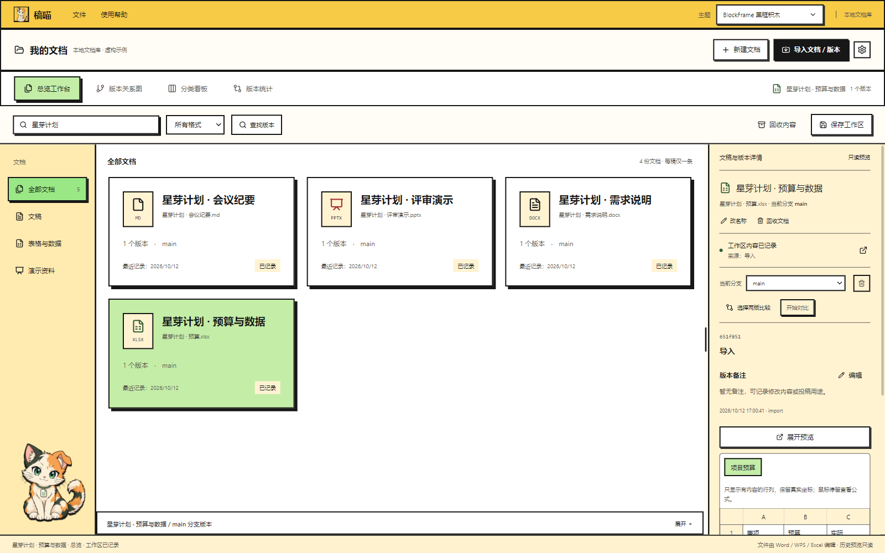

图中给相关文档加了统一的“星芽计划”前缀。搜索项目名，即可汇集这些资料；点击一张卡片，再查看该文档自己的版本、分类和统计。

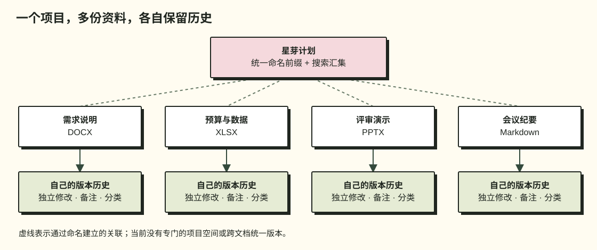

*虚线表示使用者通过命名建立的项目关联，不是软件中的项目分组或版本连接线。*

推荐这样整理：

1. 给文档使用统一项目前缀，例如 `星芽计划 · 需求说明`。
2. 将现有资料分别导入，每份文档保留独立历史。
3. 用版本名称和备注记录修改目的，例如“评审后修订”“预算第二轮”。
4. 用搜索和文件类型筛选查找资料；需要交付时导出对应版本。

**目前采用平铺文档库，不提供专门的项目空间、跨文档统一版本、团队权限或多人实时协作。** 这里的项目管理指相关文档的集中整理与各自版本管理。

## 挑一个喜欢的工作台

七种固定主题覆盖黑框积木、浅色办公、纸张书房、石墨暗色、粉绿方块、经典视窗和胶囊文具，另支持跟随系统。主题切换保留同一份文档与历史。

| 粉绿方块 | 经典视窗 | 胶囊文具 |
| --- | --- | --- |
| 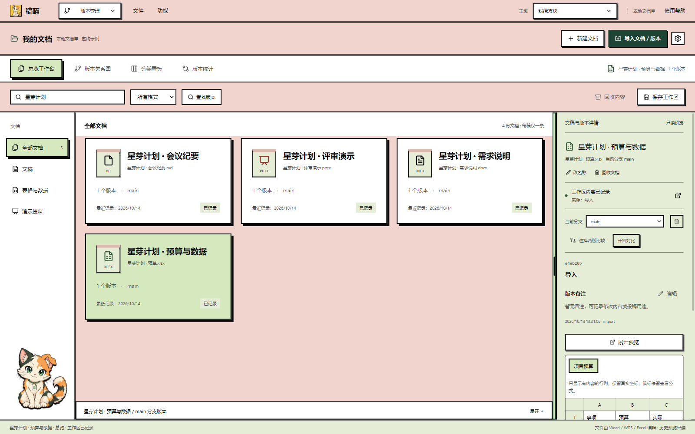 | 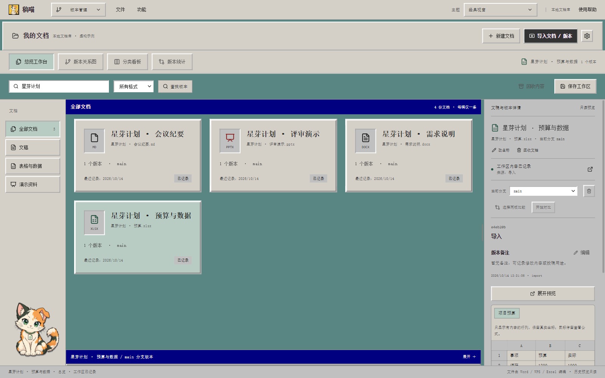 | 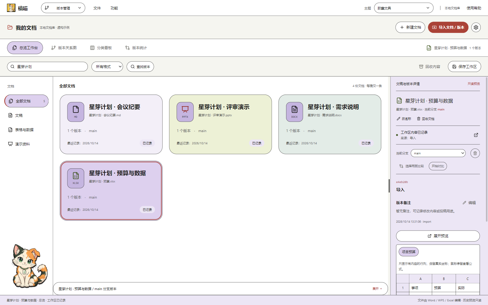 |
| 粉色与浅绿搭配，方块卡片和硬边投影 | 复古窗口、立体控件与桌面软件质感 | 圆润控件、胶囊按钮与文具配色 |

左下角的小猫支持点击互动和右键抚摸。版本关系图还提供 Riffle、Drawer、Terminal、Cabinet、Turntable 五种鼠标互动视效，可在视效上右键切换。

## 安装与开始使用

**支持 Windows 10 / 11，x64。当前版本：v0.4.0，公开测试版。**

1. 从 [最新发布页](https://github.com/gezaifeng/DocKitty/releases/latest) 下载安装包，也可直接下载 [DocKitty-Setup-0.4.0-x64.exe](https://github.com/gezaifeng/DocKitty/releases/download/v0.4.0/DocKitty-Setup-0.4.0-x64.exe)。
2. 双击安装，从桌面或开始菜单打开“稿喵”，直接进入文档管理界面。
3. 点击“导入文档 / 版本”，导入第一份文档；已有历史稿可继续导入为这份文档的不同版本。
4. 选中文档，切换关系图、分类或统计；右键版本卡片查看可用操作。

安装包已包含运行环境，普通用户**不需要安装 Node.js、pnpm、Python 或 Git**。安装和基本文档管理可离线使用；编辑办公文件仍需已安装的 Word、WPS、Excel 或其他关联程序。安装包目前没有代码签名，Windows 可能显示未知发布者提示。

更详细的操作步骤见 [使用教程](docs/使用教程.md)。

## 文件与数据：使用前了解这几点

| 项目 | 当前行为 |
| --- | --- |
| 保存位置 | 安装版默认使用当前用户的数据目录；可在设置中自定义位置 |
| 日常编辑 | 使用独立编辑副本，普通修改不直接改写导入来源文件 |
| 删除版本 | 可从版本管理中移除；彻底删除来源文件属于单独选项，需要确认具体路径 |
| 备份 | 支持文档库备份与恢复；重要资料建议额外保留独立备份 |
| 卸载 | 不主动删除用户数据目录 |
| 文件格式 | 可保存多种文件的版本；预览、比较和统计的支持范围因格式而异 |

旧式 DOC / XLS 等文件可用于保存版本，但内容解析能力有限。复杂排版、公式计算和最终打印效果请在办公软件中确认。稿喵管理文稿历史，内置预览不替代专业编辑器。

软件当前不提供云同步或团队协作。仓库和安装包均不包含作者论文、个人文档库、测试历史或账户凭据。

## 开发与构建

<details>
<summary>开发者：本地运行、检查与安装包构建</summary>

仅开发或自行构建需要 Node.js 22+、pnpm 9.15.0。

```powershell
pnpm install --frozen-lockfile
pnpm -r run typecheck
pnpm -r run test
pnpm --filter @wordgit/desktop build
pnpm e2e
pnpm package:installer
```

安装包输出到 `dist/releases`，内部包含 Electron 和打包后的依赖。自动化测试使用隔离文档库；`WORDGIT_ELECTRON` 可指定 Electron 运行环境。与 Word / WPS 的实际编辑配合仍应在目标机器上验证。

本仓库为软件源代码的公开快照；本文截图仅用于功能说明，不构成所有文件格式的兼容性保证。

</details>

## 第三方与反馈

Hairline 0.5.0（Lucas Marques，MIT）用于 Riffle、Drawer、Terminal、Cabinet、Turntable。原版许可保留于源码和安装目录，参见 [第三方说明](THIRD_PARTY_NOTICES.md)。其他依赖见各包清单。

遇到问题欢迎提交 [Issue](https://github.com/gezaifeng/DocKitty/issues)，附上软件版本、文件格式、复现步骤及隐去敏感信息的截图。请勿上传未公开论文或私人文档。

